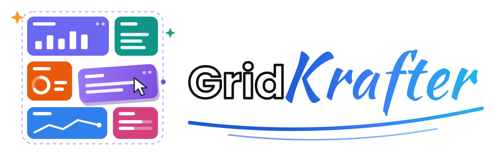
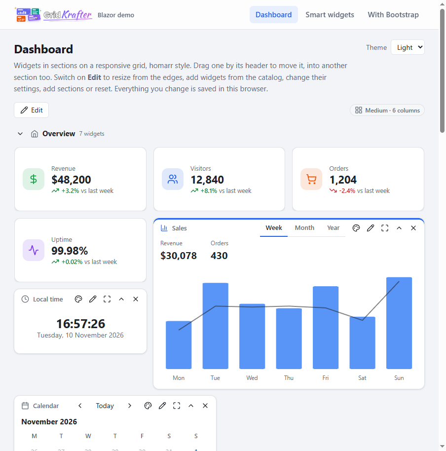
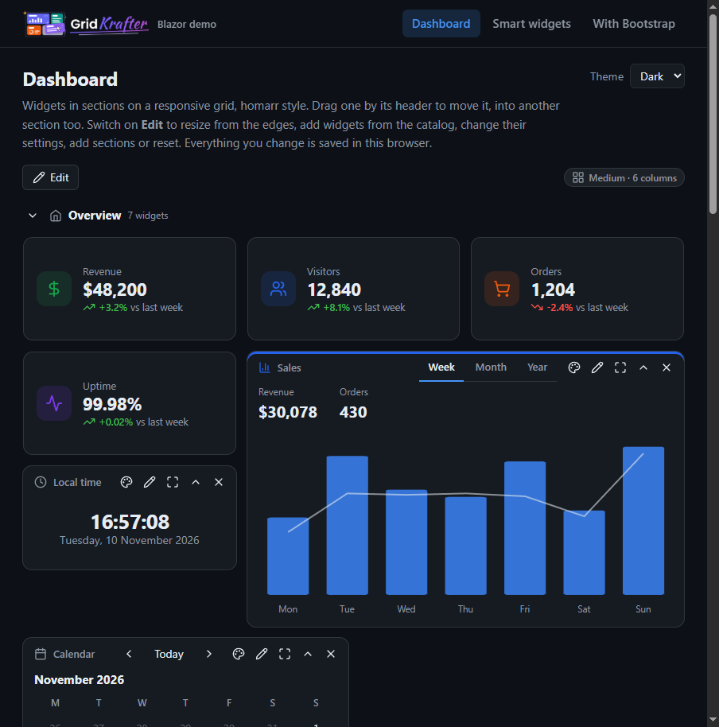

Dashboards for .NET. Widgets on a responsive, sectioned grid like. Drag them, resize them, collapse them, rename them, recolour them, make them full screen, add more from a catalog and delete them. Every change gives you the whole board as JSON, ready to save.

## Screenshots
 

The same component works in **Blazor**, **ASP.NET Core MVC / Razor Pages**, and, as a custom element, in **React or any plain HTML page**. It has light and dark modes and looks at home next to Bootstrap without needing it.

## Projects

| Project | What it is |
| --- | --- |
| `GridKrafter.Core` | The board model, the grid engine (placement, collisions, compaction, breakpoints), JSON and the language catalogs. No UI. |
| `GridKrafter.Components` | The `Dashboard`, `Widget` and `DashboardElement` Razor components, with `gridkrafter.css` and `gridkrafter.js`. |
| `GridKrafter.CustomElements` | A Blazor WebAssembly app that registers `<gk-dashboard>`. |
| `GridKrafter.Demo.Blazor` | Blazor Server demo: a dashboard, the classic SmartWidgets page rebuilt, and a Bootstrap page. |
| `GridKrafter.Demo.Mvc` | MVC demo. Widgets are partial views fetched by URL and templates in the view; the board is saved on the server. |
| `gridkrafter.demo.react` | React (Vite) demo. The widgets are React components rendered into the custom element. |
| `GridKrafter.Tests` | xUnit tests for the grid engine, merging saved boards, JSON, colours and languages. |

## Blazor

```csharp
builder.Services.AddGridKrafter(options => options.Widgets
    .Add<SalesChart>("sales", d =>
    {
        d.Name = "Sales chart";
        d.Icon = "chart";
        d.W = 6;
        d.H = 5;
        d.Options = [WidgetOption.Select("range", "Range", "week", ("week", "This week"), ("month", "This month"))];
    }));
```

```html
<link rel="stylesheet" href="@Assets["_content/GridKrafter.Components/gridkrafter.css"]" />
```

Declare the board in markup. Widgets with a `Kind` come from the registry; the others carry their own content.

```razor
<Dashboard Theme="auto" StorageKey="home" ShowToolbar OnChanged="OnChanged">
    <WidgetSection Id="overview" Title="Overview" Icon="home">
        <DashboardWidget Id="sales" Kind="sales" Title="Sales" X="0" Y="0" W="8" H="5" />
        <DashboardWidget Id="about" Title="About" Icon="info" X="8" Y="0" W="4" H="3" AutoHeight>
            <p>Column @(context.Rect.X + 1), row @(context.Rect.Y + 1).</p>
        </DashboardWidget>
    </WidgetSection>
</Dashboard>
```

Or pass a `DashboardBoard` to `Board`, built in code or parsed with `DashboardJson.TryParse`.

`DisplayMode` is `Tabs` by default: one section shows at a time, and dragging a widget onto another tab moves it there. `Accordion` is the stacked layout, where each section collapses on its own. Every section has buttons to collapse or expand all of its widgets.

A registered widget inherits `WidgetComponentBase`. `Option(key, fallback)` reads its settings, `Context.SetOptionAsync` saves one with the board, and `OnRefreshAsync` runs when it's refreshed:

```razor
@inherits WidgetComponentBase

<p>Showing @Option("range", "week").</p>

@code {
    protected override Task OnRefreshAsync() => LoadAsync();
}
```

`Widget` on its own is the frame without the grid: header, buttons, collapse, full screen, colour, edit panel, toolbar, body toolbar and footer.

## Saving boards

`StorageKey` keeps the board in the browser's local storage. To save it anywhere else, handle `OnChanged`: each `DashboardChange` says what happened (`Moved`, `Resized`, `Options`, `Added` and so on) and carries the whole board. Save `DashboardJson.Serialize(change.Board)` and pass it back as `SavedBoard`.

A saved board is applied over the board the page defines, so the page stays in charge. People keep their arrangement, titles, colours, settings and the widgets they added. Content and limits come from the page, and widgets added to the page later still show up.

Positions are kept per layout. The defaults are `large` (12 columns from 1100px), `medium` (6 columns from 640px) and `small` (1 column). A layout nobody has arranged is worked out from the next larger one. Pass `Layouts` for your own breakpoints.

## MVC

Render `DashboardElement` with `render-mode="Server"` (add `AddServerSideBlazor()` and `MapBlazorHub()`):

```html
<div id="dashboard">
    <component type="typeof(DashboardElement)" render-mode="Server"
               param-Board="@Model.Board" param-Saved="@Model.Saved" param-ShowToolbar="true" />
</div>
```

Widget content can be an HTML string (`html`), a URL fetched into the widget (`url`, fetched again on refresh, and scripts in it run), or a `<template>` in the page (`template`, a CSS selector). Listen for `gk-changed` and send `event.detail.board` to your server, or set `param-Name` to post it with a form. See `GridKrafter.Demo.Mvc`.

`html`, `url` and `template` are trusted: they're rendered as they are. Don't save them from a board that came back from the browser. Take content from the page's own board, which is what `BoardMerge` does with `Saved`.

## React and plain HTML

Publish `GridKrafter.CustomElements` and serve its `wwwroot`. The page needs the stylesheet, then:

```html
<gk-dashboard id="dashboard" storage-key="home" show-toolbar="true" theme="auto"></gk-dashboard>
<script src="_framework/blazor.webassembly.js"></script>
<script>
  dashboard.setAttribute('board', JSON.stringify({ sections: [], items: [{ id: 'hello', title: 'Hello', w: 4, h: 2, html: '<p>Hi!</p>' }] }));
  dashboard.addEventListener('gk-changed', e => console.log(e.detail.kind, e.detail.board));
</script>
```

Attributes are kebab-case: `board`, `saved`, `catalog`, `layouts`, `theme`, `language`, `storage-key`, `show-toolbar`, `display-mode` (`tabs`, `accordion`), `edit-mode`, `read-only`, `float`, `row-height`, `gap`, `chrome` (`panel`, `card`, `plain`), `buttons`, `buttons-on-hover`, `confirm-delete`, `move-without-edit-mode`, `name`.

| Event | `detail` |
| --- | --- |
| `gk-ready` | `{ layout, board }` once it has measured itself and restored any saved board |
| `gk-changed` | `{ kind, itemId, sectionId, layout, board }` |
| `gk-layout` | `{ id, columns, minWidth }` when the breakpoint changes |
| `gk-mounts` | `{ mounts: [{ id, kind, section }] }`: the widget bodies left empty for you |
| `gk-refresh` | `{ id, kind }` |
| `gk-edit-mode` | `{ editing }` |

A widget with no content of its own leaves its body, `[data-gk-mount="id"]`, empty, so React, Vue or plain script can render into it. Its content saves a setting by dispatching `gk-option` from inside the widget:

```js
body.dispatchEvent(new CustomEvent('gk-option', { bubbles: true, detail: { key: 'items', value: tasks } }))
```

The setting becomes part of the board, so it comes back in `gk-changed` and is saved with everything else. `gridkrafter.demo.react` has a small wrapper, `GridKrafter.jsx`, that portals a React component into each mount. It passes the component its settings and `setOption`, and keeps the component's state when the widget moves to another section.

## Widgets

- **Frames:** `Panel` (coloured header), `Card`, or `Plain` (no header, buttons in edit mode).
- **Buttons:** refresh, colour, edit, full screen, collapse and delete, chosen per widget or for the whole dashboard, optionally shown only on hover.
- **Colours:** sixteen named colours, or a hex, `rgb()`, `hsl()` or `oklch()` colour of your own.
- **Settings:** text, text area, number, range, switch, select and colour fields in the edit panel, from the widget's definition.
- **Sizing:** minimum and maximum sizes; `AutoHeight` widgets grow and shrink with their content; `Locked` widgets stay put.
- **Refresh:** `Refresh` in seconds refreshes a widget by itself and shows when it was last updated.
- **Keyboard:** the grip in each header moves the widget with the arrow keys, and resizes it with Shift and the arrow keys.

## Themes

`Theme` is `light`, `dark`, `auto` (follows the system) or `bootstrap` (takes Bootstrap's variables and `data-bs-theme`). Everything is drawn from `--gk-*` CSS variables, and widget content can use the same variables and helpers: `gk-list`, `gk-table`, `gk-badge`, `gk-progress`, `gk-tabs`, `gk-button`, `gk-input`.

## Languages

English, German, Spanish, French, Brazilian Portuguese, Simplified Chinese and Arabic (right to left) are built in. `AddGridKrafter(o => o.Localization.Directory = "Locales")` loads extra `{tag}.json` files, which override the built-in strings key by key.

## Credit

Inspired by the discontinued JarvisWidgets from a legacy version of [SmartAdmin](https://wrapbootstrap.com/theme/smartadmin-responsive-webapp-WB0573SK0), with ideas from projects like [homarr](https://github.com/homarr-labs/homarr), [gridstack.js](https://github.com/gridstack/gridstack.js) and [React-Grid-Layout](https://github.com/react-grid-layout/react-grid-layout).

## Support

If you find this project useful, consider supporting its development.

<p align="center">
  <a href="https://buymeacoffee.com/vnmatt">
    
  </a>&nbsp;&nbsp;&nbsp;
  <a href="https://www.paypal.com/cgi-bin/webscr?cmd=_donations&business=gordon_matt%40live%2ecom&lc=AU&currency_code=AUD&bn=PP%2dDonationsBF%3abtn_donateCC_LG%2egif%3aNonHosted">
    
  </a>
</p>

<p align="center">
  Prefer using your phone? Scan the QR code:
</p>

<p align="center">
  <a href="https://buymeacoffee.com/vnmatt">
    
  </a>
</p>

